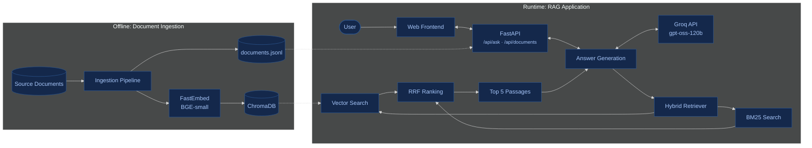
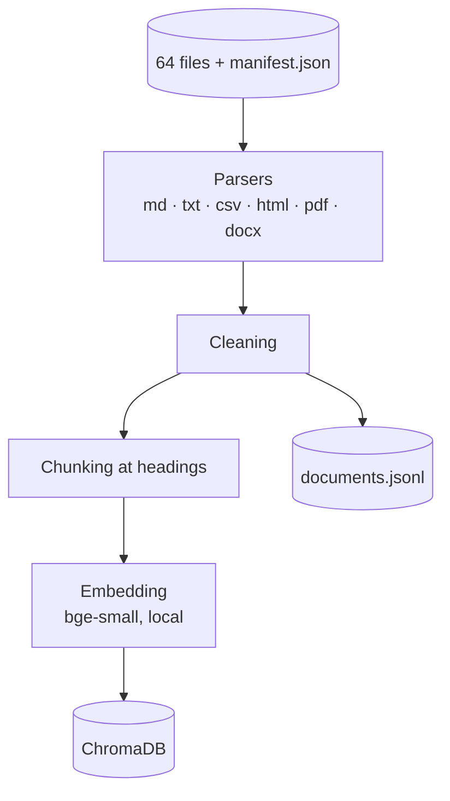
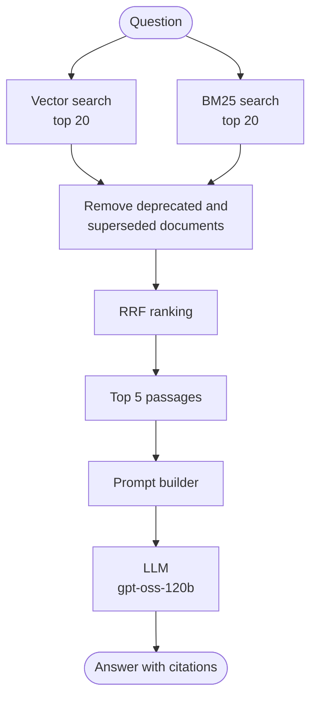

# Northgate Handbook Assistant

A question-answering assistant for the Northgate Robotics employee handbook. Employees ask a question in plain language and get a short answer drawn only from the handbook, with numbered citations that open the exact passage it came from.

It is a RAG (retrieval-augmented generation) system written in plain Python: it finds the most relevant handbook passages with hybrid search, then asks an LLM to answer from those passages only.

- **64 handbook documents in six formats**: Markdown, plain text, CSV, HTML, PDF and Word.
- **Hybrid retrieval**: vector search plus BM25 keyword search, combined with Reciprocal Rank Fusion.
- **Follows the handbook's own rules**: deprecated and superseded documents are never used; future-dated policies and meeting notes are labelled.
- **Honest answers**: when the handbook does not cover a question, the assistant says so instead of guessing.
- **Web page**: ask a question, click a citation, and read the source document with the cited passage highlighted, or open the original file.
- **Evaluation**: my own 55-question set, scoring retrieval and answers separately (see [Evaluation](#evaluation)).

Design decisions and results are in [DECISIONS.md](DECISIONS.md); how AI tools were used is in [AI_USAGE.md](AI_USAGE.md).

## Architecture

### 1. System Architecture



### 2. Document Ingestion Pipeline



### 3. Question Answering Pipeline



## Tech stack

| Purpose | Choice |
|---|---|
| Language | Python 3.11, no LLM framework |
| Parsing | pypdf, python-docx, BeautifulSoup, standard-library `csv` |
| Embeddings | `BAAI/bge-small-en-v1.5` via fastembed (local, ONNX Runtime) |
| Vector store | ChromaDB (persistent, local) |
| Keyword search | rank-bm25 |
| LLM | `openai/gpt-oss-120b` on Groq, through the OpenAI-compatible API |
| Backend | FastAPI and Uvicorn |
| Frontend | HTML, CSS, JavaScript (no build step) |
| Tests | pytest |

## Getting started

### Requirements

- **Python 3.11**. Newer versions may not have wheels for every dependency yet.
- **A free Groq API key** from [console.groq.com/keys](https://console.groq.com/keys). Any OpenAI-compatible provider also works (see [Configuration](#configuration)).
- About **300 MB** of disk space for the dependencies and the embedding model.

### 1. Install

```bash
git clone <repository-url>
cd <repository-folder>
python3.11 -m venv .venv
source .venv/bin/activate          # Windows: .venv\Scripts\activate
pip install -r requirements.txt
```

### 2. Configure

```bash
cp .env.example .env
```

Open `.env` and set `LLM_API_KEY` to your Groq key. `.env` is git-ignored; never commit it.

### 3. Build the index

```bash
python -m scripts.ingest
```

This parses `data/raw/`, writes `data/processed/documents.jsonl` and `chunks.jsonl`, and builds the vector index in `data/index/`. The first run downloads the embedding model (about 64 MB) into `data/models/`. Expected output:

```
Wrote 64 documents and 123 chunks to .../data/processed
Indexed 123 chunks in .../data/index
```

Everything under `data/` except `data/raw/` is generated and can be deleted and rebuilt with this command.

### 4. Run the app

```bash
uvicorn app.main:app --reload
```

Open **http://localhost:8000**. Interactive API documentation is at **http://localhost:8000/docs**.

## Using the API

| Method | Path | Description |
|---|---|---|
| `POST` | `/api/ask` | Body `{"question": "..."}` (1 to 500 characters). Returns `{"answer": "...", "citations": [...]}`. Each citation has the document id, title, section, passage text, effective date and labels. |
| `GET` | `/api/documents/{doc_id}` | The full parsed document and its manifest metadata. |
| `GET` | `/api/documents/{doc_id}/file` | The original file (PDF, Word, etc.) from `data/raw/`. |
| `GET` | `/` | The web page. |

```bash
curl -X POST http://localhost:8000/api/ask \
  -H "Content-Type: application/json" \
  -d '{"question": "How much paid leave does a secondary caregiver get?"}'
```

Errors: an invalid question returns `422`, an unknown document `404`, and an unavailable LLM (for example, a reached rate limit) `503` with the reason.

## Configuration

All settings come from `.env` (see `.env.example`):

| Variable | Default | Meaning |
|---|---|---|
| `LLM_BASE_URL` | `https://api.groq.com/openai/v1` | Any OpenAI-compatible API: Groq, Gemini, OpenAI, or a local Ollama (`http://localhost:11434/v1`) |
| `LLM_API_KEY` | (none, required) | API key for that provider |
| `LLM_MODEL` | `openai/gpt-oss-120b` | Model name at that provider. `openai/gpt-oss-20b` is a drop-in backup on Groq. |
| `LLM_REASONING_EFFORT` | `low` | `low`, `medium` or `high` for reasoning models; leave empty for other models |
| `LLM_MAX_TOKENS` | `1024` | Maximum tokens per answer, reasoning included |
| `TODAY` | real date | Fix "today" (`YYYY-MM-DD`) for repeatable runs |

Switching model or provider needs no code change. Every LLM call is logged to `data/logs/llm_usage.jsonl`; `python -m scripts.token_usage` shows the tokens used today.

## Tests

```bash
pytest -m "not slow"     # 140 fast tests, about 5 seconds: no model, no network
pytest                   # all 147 tests, including 7 that load the real embedding model
pytest tests/test_api.py # a single file
```

No test calls the LLM. Tests use small fakes (`tests/fakes.py`) in place of the embedding model, the retriever and the LLM, so they run offline and cost nothing. They cover the parts that can break: each file parser (including the hotel-rate table inside the Word file), chunking, BM25, hybrid ranking and the removal of outdated documents, citation parsing, the API, and the evaluation's own grading.

## Evaluation

No test questions were provided, so `eval/questions.json` holds 55 questions I wrote from the documents. Each has the expected source documents and the facts a correct answer must (and must not) contain. They cover lookups, tables, every file format, conflicting versions, exact codes and names, paraphrases, multi-document questions, date-dependent questions and questions the handbook cannot answer.

```bash
python -m eval.run_retrieval_eval   # retrieval only: no LLM calls, free
python -m eval.run_answer_eval      # full answers on 29 questions: about 27k tokens on first run
```

The answer evaluation caches every model answer in `eval/results/`, so re-running it costs no tokens unless the prompt changes. Both scripts write a Markdown report to `eval/results/`.

| Evaluation | Result |
|---|---|
| Retrieval (49 questions) | Hit@1: 92% hybrid vs 88% vector-only vs 65% BM25-only. An outdated document appeared in the top 5 for 15 questions with vector-only search and 0 with hybrid. |
| Answers (29 hardest questions) | 24/29 fully correct: conflicts 8/8, unanswerable questions 6/6 refused. None of the 5 misses is an invented answer. |

Details and analysis: [DECISIONS.md](DECISIONS.md#5-results).

## Project structure

```
project/
│
├── app/
│   ├── main.py
│   ├── config.py
│   ├── api/              # FastAPI routes, schemas and dependencies
│   ├── ingestion/        # Document parsing, cleaning and chunking
│   ├── retrieval/        # Embeddings, ChromaDB, BM25 and RRF
│   └── generation/       # LLM integration, prompts and answer generation
│
├── frontend/             # Web interface
├── scripts/              # Document ingestion and utility scripts
├── eval/                 # Evaluation questions, scripts and results
├── tests/                # Automated tests
│
├── data/
│   ├── raw/              # Original source documents
│   ├── processed/        # Extracted documents and chunks
│   ├── index/            # ChromaDB vector index
│   └── models/           # Downloaded embedding models
│
├── .env.example
├── requirements.txt
├── pyproject.toml
├── DECISIONS.md
├── AI_USAGE.md
└── README.md
```

## Troubleshooting

| Problem | Fix |
|---|---|
| `RuntimeError: The index is not built` when starting the app | Run `python -m scripts.ingest` first. |
| `LLM_API_KEY is not set` | Copy `.env.example` to `.env` and add your key. |
| The page shows "The language model is unavailable right now" | The provider refused the call, usually a rate or daily limit. Check `python -m scripts.token_usage`, wait, or set `LLM_MODEL=openai/gpt-oss-20b` and restart. |

## Limitations

- Retrieval is single-step: questions that need a fact from one document to find another (for example, Denver → its city tier → the hotel cap) can be answered only partially.
- No conversation memory: each question is answered on its own.
- Not deployed, and there is no document upload. Both are listed as next steps in [DECISIONS.md](DECISIONS.md#6-what-i-would-do-with-one-more-week).
